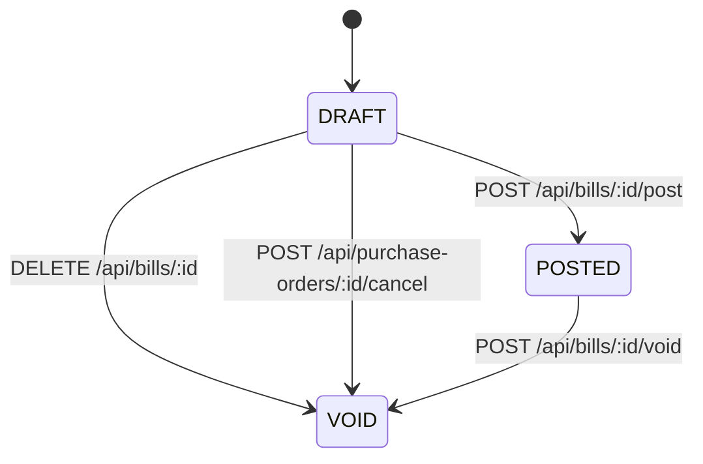
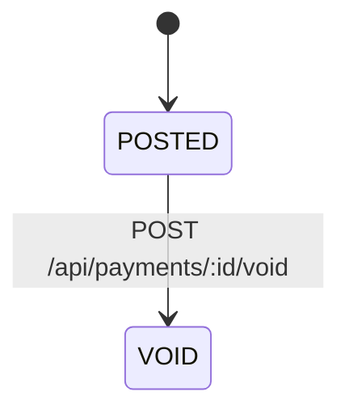
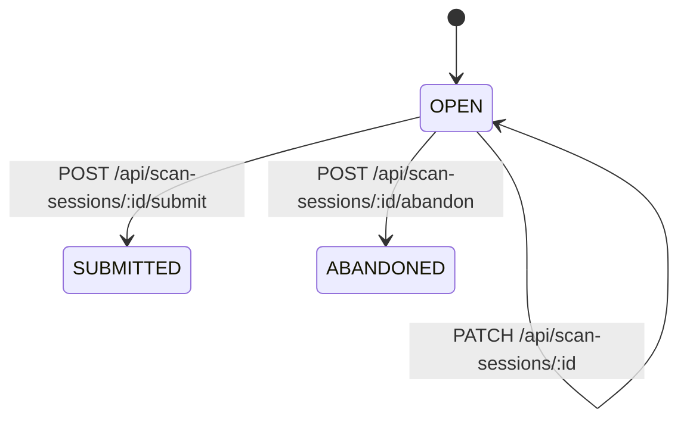
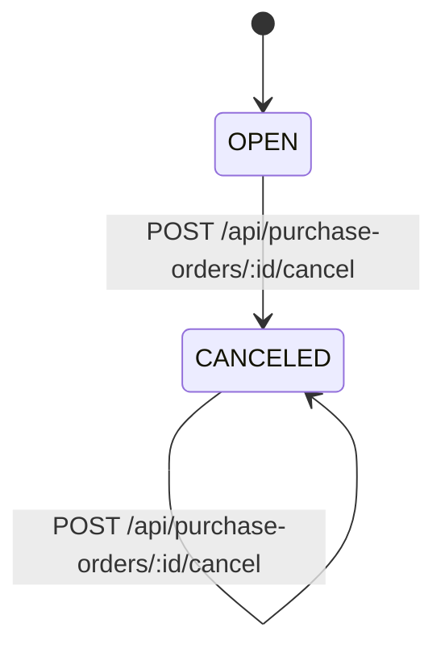
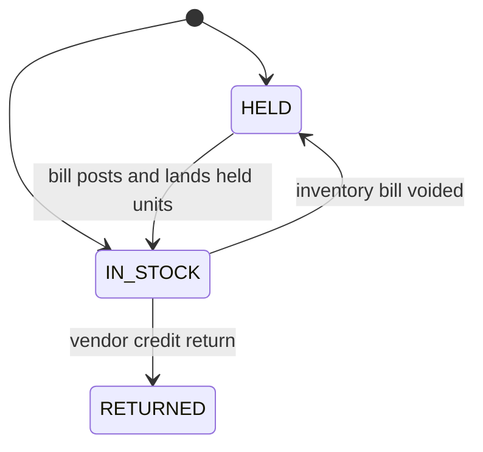
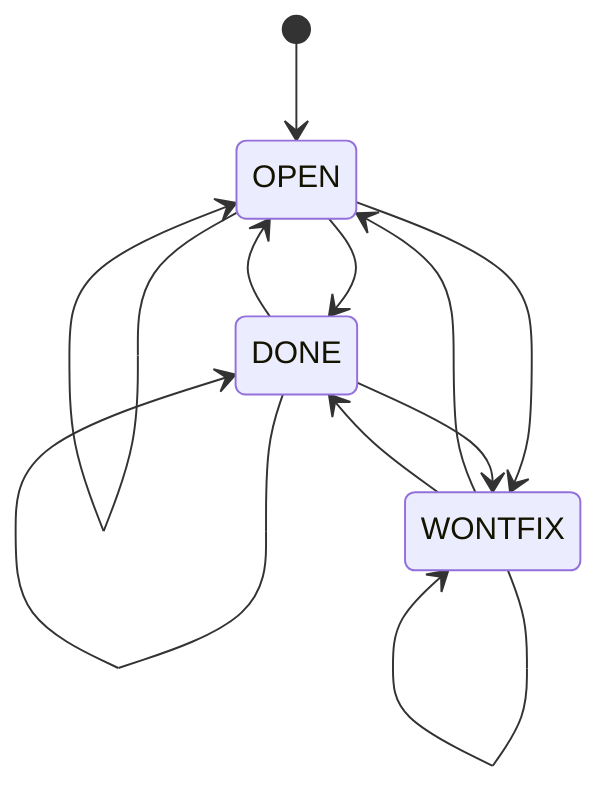
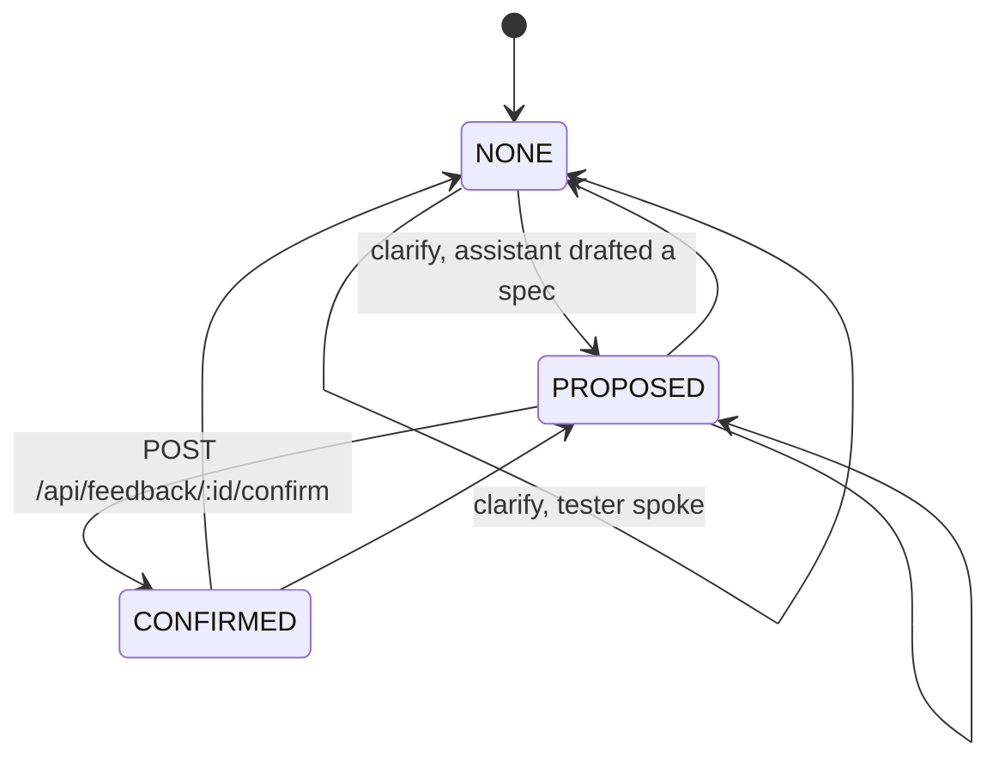
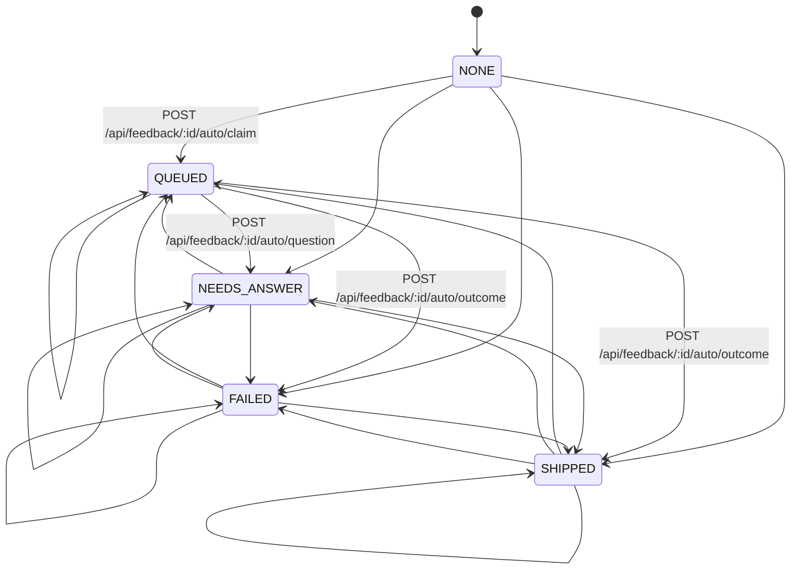

# State machines

Status columns are plain text. There is no `CHECK` constraint on them in the migrations. Every status write in the API goes through one compare-and-set (`updateMany` where the current state is a legal source of the target). A lost race is HTTP 409.

`GET /api/state-machines` returns `{ machines, derived }`. `machines` is the table below (`initial` plus `edges`). `derived` is the four computed axes, which are never set by a transition.

When a caller does not pass its own sentence, an illegal move says `Bill is void; it is final` or `Bill is posted; it can only go to void` (the label, the current state in lowercase, then either `it is final` or `it can only go to` the lowercase targets). The sentences below are the ones the routes already return. Those stay verbatim.

## Bill

States: DRAFT (initial), POSTED, VOID. VOID is final.

| Edge | What triggers it | Illegal move |
|---|---|---|
| DRAFT → POSTED | `POST /api/bills/:id/post` (inventory and freight). Also requires the version the client last read. | `{number} is already {status}` when it is not a draft. `{number} was posted or changed by someone else. Reload it.` when the compare-and-set loses. |
| DRAFT → VOID | `DELETE /api/bills/:id` discards one draft. Cancel voids every draft on that order; zero drafts is success. | `Only a draft bill can be discarded; void a posted one instead` |
| POSTED → VOID | `POST /api/bills/:id/void` | `{number} is {status}, not posted` |

## Payment

States: POSTED (initial, the column default on create), VOID. VOID is final.

| Edge | What triggers it | Illegal move |
|---|---|---|
| POSTED → VOID | `POST /api/payments/:id/void` | `That payment is already void` |

## Delivery (scan session)

States: OPEN (initial), SUBMITTED, ABANDONED. SUBMITTED and ABANDONED are final. Editing an open session stays OPEN.

| Edge | What triggers it | Illegal move |
|---|---|---|
| OPEN → OPEN | `PATCH /api/scan-sessions/:id` sets vendor, order, notes, or the slip and leaves the session open. | `This delivery is already finished` |
| OPEN → SUBMITTED | `POST /api/scan-sessions/:id/submit` | `This delivery was already finished` |
| OPEN → ABANDONED | `POST /api/scan-sessions/:id/abandon` | `Only an unfinished delivery can be abandoned` |

Appending scans to a session that is not OPEN is refused with `This delivery was already finished; start a new one to scan more`. Resolving an unknown before SUBMITTED is refused with `Finish the delivery before resolving its unknown items`. Neither write changes the status.

`GET /api/scan-sessions` takes `status` of OPEN, SUBMITTED, or ABANDONED. The default is OPEN.

## Purchase order lifecycle

States: OPEN (initial), CANCELED. Nothing writes CLOSED. Cancel is idempotent: a canceled order can be canceled again and stays CANCELED.

| Edge | What triggers it | Illegal move |
|---|---|---|
| OPEN → CANCELED | `POST /api/purchase-orders/:id/cancel`, after it voids any drafts. | `{number} has received stock and can't be cancelled` or `{number} has a posted bill; void the bill first`. Those are refused before the lifecycle write. |
| CANCELED → CANCELED | The same cancel route, called again. | The second call succeeds. The order stays CANCELED. |

`GET /api/purchase-orders` accepts `lifecycle` of OPEN (the default), CANCELED, CLOSED, or ALL. ALL omits the filter. CLOSED matches the column exactly, so it returns no rows. A typo is 400.

Receiving against an order that is not OPEN is refused with `{number} is {lifecycle}; receive against an open order`.

## Serial unit

States: HELD (initial, and the state written when units are received before a bill), IN_STOCK, RETURNED. RETURNED is final. A receipt can also insert IN_STOCK directly when the units are already billed. That is a create, not a move from HELD.

`HELD` on the stock register (`ON_HAND` / `HELD` buckets) is a different word. It is not this machine.

| Edge | What triggers it | Illegal move |
|---|---|---|
| HELD → IN_STOCK | Posting an inventory bill lands the held serials on that receipt line. | The serials were just read as HELD in the same transaction. A miss rolls the post back. |
| IN_STOCK → HELD | Voiding an inventory bill puts those serials back on hold and clears the lot. | Same: they were just read as IN_STOCK. |
| IN_STOCK → RETURNED | A vendor credit that returns named serials which are in stock on that bill. | `{name}: one of those serials is not in stock on this bill` (checked before the write). |

## Feedback status

States: OPEN (initial), DONE, WONTFIX. Any of them may be written from any of them, including writing the state the note is already in.

| Edge | What triggers it | Illegal move |
|---|---|---|
| any → OPEN, DONE, or WONTFIX | `PATCH /api/feedback/:id` with `{ status }`. The auto outcome may also set DONE or OPEN in the same write as the job state. | A missing note is `That record was not found` (404). |

`GET /api/feedback` accepts `status` of OPEN, DONE, or WONTFIX.

## Feedback spec

States: NONE (initial), PROPOSED, CONFIRMED.

| Edge | What triggers it | Illegal move |
|---|---|---|
| any → NONE | `POST /api/feedback/:id/clarify` when the tester sends a message. The previous spec is dropped. | The row is locked for the write. |
| any → PROPOSED | The same route, when the assistant returns a spec. | The row is locked for the write. |
| PROPOSED → CONFIRMED | `POST /api/feedback/:id/confirm` with the revision the client confirmed. | `There is no proposed spec to confirm` |

## Feedback auto

States: NONE (initial), QUEUED, NEEDS_ANSWER, FAILED, SHIPPED. Nothing writes NONE again. Claim, outcome, and question may move from whatever the job state is now, because those writes guard the claim and the revision, not the previous auto state.

| Edge | What triggers it | Illegal move |
|---|---|---|
| any → QUEUED | `POST /api/feedback/:id/auto/claim`. The note must be OPEN, the revision must match, and no run may hold it. | `The note moved on or is held by another run` |
| any → FAILED, SHIPPED, or QUEUED | `POST /api/feedback/:id/auto/outcome` while that run holds the claim at that revision. Replaying the same outcome succeeds. | `The note moved on or is held by another run` |
| any → NEEDS_ANSWER | `POST /api/feedback/:id/auto/question` while that run holds the claim. | `The note moved on or is held by another run` |

## Derived axes

These are recomputed, not transitioned. `refreshPoStatus` writes billing, payment, and receiving. `refreshReceiptState` writes the receipt state from `receiptState()`.

| Axis | Values |
|---|---|
| billingStatus | NOT_BILLED, DRAFT, BILLED |
| paymentStatus | UNPAID, PARTIAL, PAID |
| receivingStatus | NOT_RECEIVED, PARTIAL, RECEIVED |
| receiptState | PENDING_BILL, PARTIAL, POSTED |

`GET /api/purchase-orders` accepts each billing, payment, and receiving value above. `GET /api/receipts` accepts `state` of PENDING_BILL, PARTIAL, or POSTED. Omitting a filter means no filter on that axis, except bills, which hide VOID unless `status` is sent.
